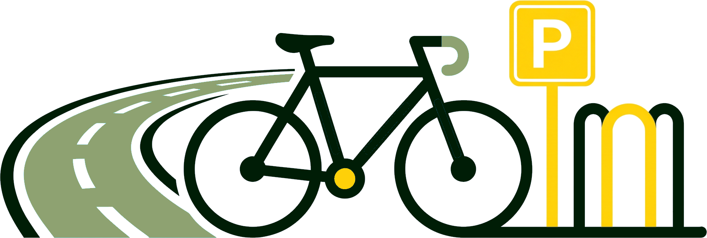
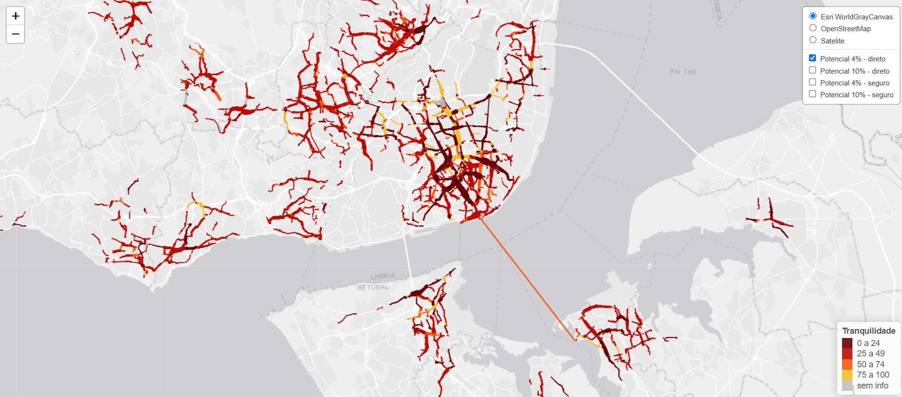
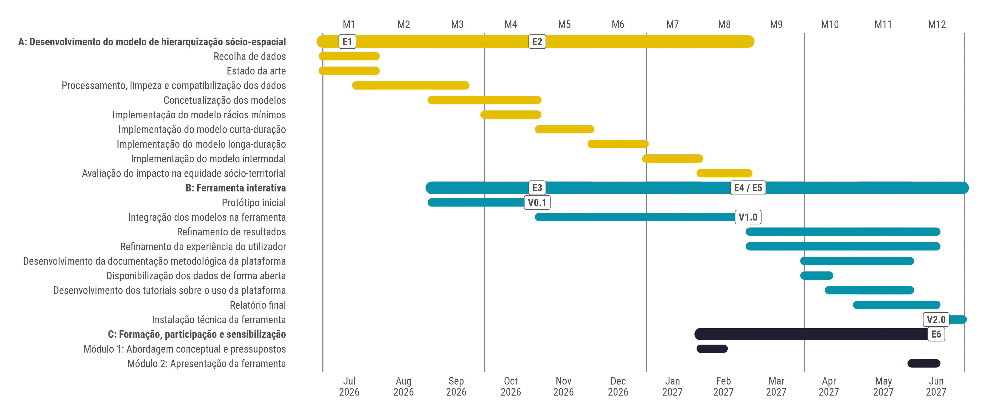
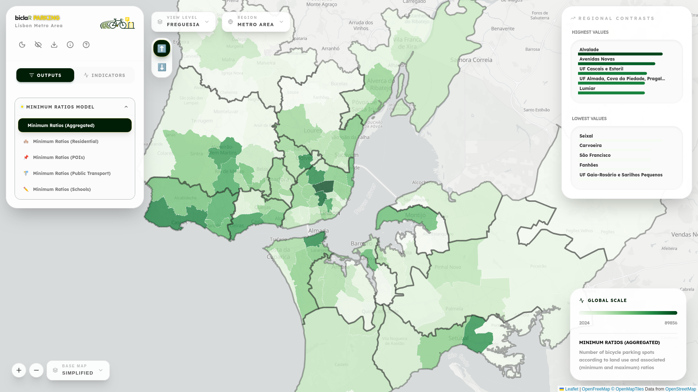

---
format:
  revealjs:
    title-slide: false
    theme: default
    fontsize: 28px
    slide-number: true
    preview-links: auto
    output-file: index
    css: styles.css
    center: true
    footer: 'Alvelos, Matos, Valério, Félix, Moura — biclaR Parking (Deliverable E2 & Prototype V0.1)'
    logo: images/logo/logo_horizontal.png
execute:
  echo: false
bibliography: ../../references.bib
link-citations: true
editor:
  render-on-save: true
---

## {.unlisted}

::::: {style="text-align: center; margin-top: 0.3em;"}

<h1 class="title" style="margin-bottom: 0.1em;">
biclaR Parking
</h1>

<h3 style="font-size: 0.95em; color: #555; margin-top: 0.2em; margin-bottom: 0.5em; font-weight: 400;">
Deliverable 2: Model Conceptualization & Interactive Prototype (V0.1)
</h3>

{width="460" style="margin-top: 0.1em; margin-bottom: 0.3em;"}

Miguel Alvelos · Gonçalo F. Matos · Francisco Valério · Rosa Félix · Filipe Moura

:::::

## Context: “original” biclaR

{fig-align="center" width="88%"}

::: {style="text-align: center; font-size: 0.88em; margin-top: 0.2em;"}
**biclaR** [@Felix_biclaR_2022]: Tool to help plan **AML’s cycling network**, based on different trip patterns and modal share objectives.

::: {.fragment}
**biclaR Parking**: Extension to **identify, dimension, and prioritize bicycle parking infrastructure** across the AML.
:::
:::

## Project Chronology

{fig-align="center" width="98%"}

::: {.fragment style="text-align: center; font-size: 0.8em; margin-top: 0.2em;"}
📍 **Status Report: E2** (*Model Conceptualization & Data Systematization*) + **E3 / V0.1** (*Initial Interactive Prototype* with Minimum Ratios Model & base layers)
:::

# 1. Base Information & Data Sources {transition="fade-in slide-out" background-color="#00330b" .section-slide}

## Spatial Units & Disaggregation

::: {.fragment}
- **Three geographic scales of analysis**:
  - **H3 Resolution 9 grid**: **25,380 hexagons** in the AML (~$0.10\text{ km}^2$ area, ~$200.7\text{ m}$ edge) — minimum analysis unit
  - **Parish (*Freguesia*)**: **124** units · **Municipality (*Município*)**: **18** units
:::

::: {.fragment}
- **Dasymetric population & household distribution**:  
  [Census 2021 (BGRI)]{.flow-pill} $\leftrightarrow$ [Land Use (COS 2023)]{.flow-pill} $\leftrightarrow$ [3D Building Volume (GBA)]{.flow-pill}
  - Redistributes residents, households, age groups & building epochs (e.g. pre-1945) to H3 cells proportionally to residential building volume.
:::

::: {.fragment}
- **OD Matrix Disaggregation (IMOB 2017)**:
  - Stochastic **Jittering** (`odjitter`) weighted by **Global Building Atlas (GBA)** building volumes to match short cycling trip granularity.
:::

## Systematization of Data Sources

::: {style="font-size: 0.84em;"}
| Dimension | Sources | Details |
|---|---|---|
| **Cycling & Road Network** | **OSM** + **TML** + **Municipalities** | Validated road/cycling network (AML + Cascais, Lisboa, Oeiras, Seixal, Sintra) classified by segregation level |
| **Existing Bike Parking** | **OSM** + **MUBi** + **CML** | *Cidade Ciclável* collaborative map + Lisbon municipal database + OSM |
| **Points of Interest (POIs)** | **OSM** (10 cat.) + **DGEEC** (4 cat.) | Retail, services, health, culture, leisure, sports, offices + student counts across 4 education levels |
| **Public Transport (PT)** | **TML Go (GTFS)** + **Ticketing** | Aggregated AML GTFS (`tidytransit`, `GTFShift`), interface hierarchy & daily validations per stop/hub |
| **Bike Thefts** | **PSP** & **GNR**   | 5-year aggregated reported bicycle thefts (urban & rural jurisdictions) |
| **Micromobility** | **GBFS** (Bird, Lime, Bolt, Gira) | High-frequency (1-min) parked vehicle locations across Lisboa, Almada, Cascais & Oeiras |
:::

# 2. Dimensioning Models {transition="fade-in slide-out" background-color="#00330b" .section-slide}

## Overview of the 4 Models

Daily bicycle parking dimensioning across **4 complementary models**:

::: {layout-ncol="2" style="margin-top: 0.4em;"}

::: {.dim-card .fragment style="background: #e8f4fd; border-left: 4px solid #2c6fad; padding: 0.75em 0.95em; border-radius: 6px;"}
**📏 3.A. Minimum Ratios Model**  
Baseline parking spots required by municipal regulations (*Almada, Seixal*) and European literature according to land use (*residential, POIs, PT stations, schools*).
:::

::: {.dim-card .fragment style="background: #fff8e1; border-left: 4px solid #ffc107; padding: 0.75em 0.95em; border-radius: 6px;"}
**☀️ 3.B. Daytime Model (Short to Medium Term)**  
Up to 2h (*Sheffield* stands) and 2–8h (enhanced security) for daytime work/study & utilitarian trips.
:::

::: {.dim-card .fragment style="background: #e8f8ee; border-left: 4px solid #28a745; padding: 0.75em 0.95em; border-radius: 6px;"}
**🌙 3.C. Nighttime Model (Long Term)**  
Overnight parking (**>8h**) in residential areas for return-home trips.
:::

::: {.dim-card .fragment style="background: #fde8e8; border-left: 4px solid #dc3545; padding: 0.75em 0.95em; border-radius: 6px;"}
**🚆 3.D. Intermodal Model**  
First & last mile cycling combined with **PT**: bike on board (*ferries/trains*) or parked at higher-hierarchy PT interfaces.
:::

:::

::: {.fragment}
- **Demand-model scenarios (ENMAC targets):** [2% (Baseline)]{.target-badge} [4% (2025)]{.target-badge} [10% (2030)]{.target-badge}
:::

## Model Specification & Socio-Territorial Equity

:::: {.columns}
::: {.column width="52%" .fragment}
### Minimum Ratios (Implemented in V0.1)
$$N_c = \sum_i \alpha_i X_i$$

- **Residential**: $\alpha_i \times \text{households}$
- **POIs**: $\alpha_i \times \text{area / capacity}$ (10 subcategories)
- **PT Stations**: $\alpha_i \times \text{daily validations}$
- **Education**: $\alpha_i \times \text{students}$ (4 levels)
- *Static cumulative benchmark* (min & max ratios)
:::

::: {.column width="48%" .fragment}
### Demand Routing & Impact Assessment
- **Routing (`r5r`)**: Jittered IMOB trips routed on *direct* & *safe* profiles with slope ($\le 5\text{ km}$ conventional, $\le 10\text{ km}$ e-bike)
- **Socio-Territorial Equity**:
  - Supply vs. demand deficit crossed with **housing vulnerability** (e.g. no garage/elevator) & demographics
  - **WHO HEAT for Cycling**:
    - 🏥 **Health**: Premature mortality avoided (physical activity, air pollution, crash risk)
    - 🌱 **Environment**: $\text{tCO}_2\text{eq}$ avoided
    - 💶 Monetized in **€** across all 3 scales
:::
::::

# 3. Interactive Prototype (V0.1) {transition="fade-in slide-out" background-color="#00330b" .section-slide}

## Dashboard Prototype

:::: {.columns}
::: {.column width="52%"}
Available at:  
🔗 **[ushift.pt/apps/biclar](https://ushift.pt/apps/biclar)**

 

**Already available in V0.1:**

::: {.incremental}
- 🗺️ **Multi-scale exploration**: H3 grid (res 9), Parish & Municipality
- 📏 **Minimum Ratios Model**: Aggregated & disaggregated (*Residential, POIs, PT, Schools* — min/max)
- 📊 **Base & Contextual Layers**: Dasymetric population, buildings, POIs, student counts, cycling network segregation, existing parking, PT validations, GBFS & PSP/GNR bike thefts
- 📥 **Open data download** (GeoJSON & CSV)
:::
:::

::: {.column width="48%"}
{fig-align="center"}

::: {style="text-align: center; margin-top: 1.2em;"}
<a href="https://ushift.pt/apps/biclar" target="_blank" style="font-size: 1.15em; background-color: #00330b; color: #ffdd00; padding: 0.55em 1.2em; border-radius: 8px; text-decoration: none; font-weight: bold;">
🚀 Dashboard
</a>
:::
:::
::::

---

## References {visibility="uncounted"}

::: {#refs}
:::
